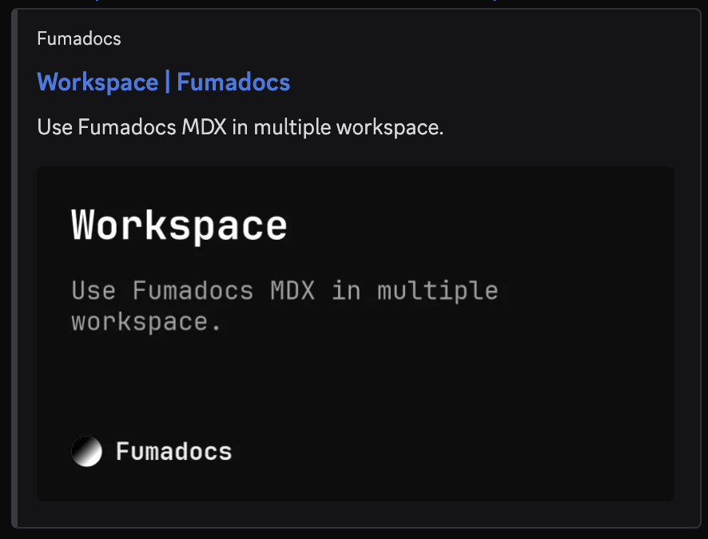

[Open Graph](https://ogp.me) の画像メタデータを設定できます。これにより、Webサイトやソーシャルメディア上でのドキュメントページのプレビュー画像を指定できます。表示例は次のとおりです。

  

画像は [Takumi](/docs/integrations/og/takumi)<show when={props.framework === 'next'}>、または [`next/og`](/docs/integrations/og/next)</show> で生成できます。

<DocsCategory />