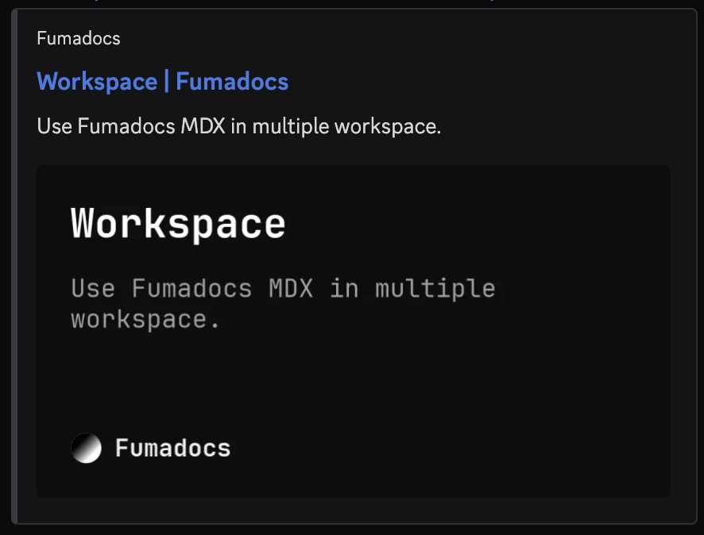

You can configure [Open Graph](https://ogp.me) image metadata, which defines the preview image of docs pages in website/social media, such as:

Generate them with [Takumi](/docs/integrations/og/takumi)<show when={props.framework === 'next'}>, or with [`next/og`](/docs/integrations/og/next)</show>.

<DocsCategory />
