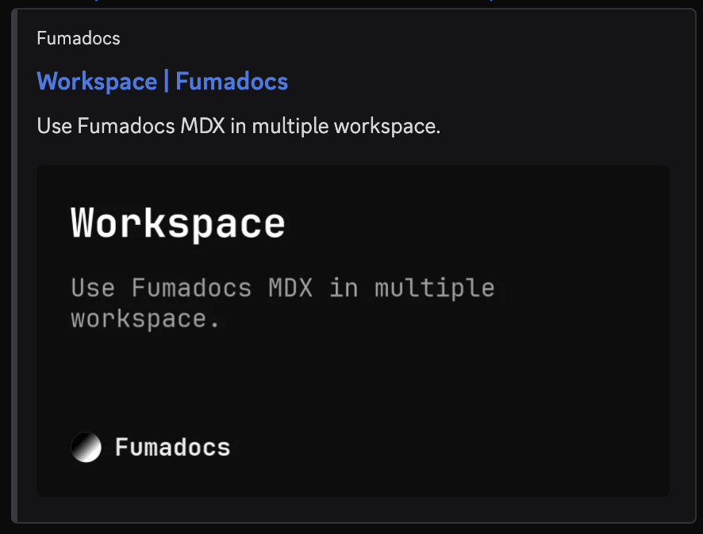

您可以設定 [Open Graph](https://ogp.me) 圖片中繼資料，用來定義文件頁面在網站或社群媒體上顯示的預覽圖片，例如：

  

您可以使用 [Takumi](/docs/integrations/og/takumi)<show when={props.framework === 'next'}>，或 [`next/og`](/docs/integrations/og/next)</show> 來產生這些圖片。

<DocsCategory />