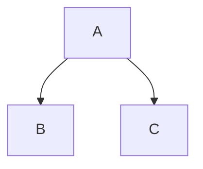

## セットアップ [#setup]

Fumadocs には Mermaid 用の組み込みラッパーが用意されていないため、`mermaid` を直接使用することをおすすめします。

設定する Mermaid のレンダラーは、次のいずれかから選択できます。

### 公式レンダラー [#official-renderer]

```npm
npm install mermaid
```

Mermaid コンポーネントを作成します。

```tsx title="components/mdx/mermaid.tsx"
'use client';

import { use, useId, useSyncExternalStore } from 'react';

export function Mermaid({ chart }: { chart: string }) {
  // サーバー側およびハイドレーション中は `false`
  const isClient = useSyncExternalStore(
    () => () => {},
    () => true,
    () => false,
  );

  if (!isClient) return;
  return <MermaidContent chart={chart} />;
}

const cache = new Map<string, Promise<unknown>>();

function cachePromise<T>(key: string, setPromise: () => Promise<T>): Promise<T> {
  const cached = cache.get(key);
  if (cached) return cached as Promise<T>;

  const promise = setPromise();
  cache.set(key, promise);
  return promise;
}

function subscribeTheme(onChange: () => void) {
  const observer = new MutationObserver(onChange);
  observer.observe(document.documentElement, { attributeFilter: ['class'] });
  return () => observer.disconnect();
}

function MermaidContent({ chart }: { chart: string }) {
  const id = useId();
  const theme = useSyncExternalStore(subscribeTheme, () =>
    document.documentElement.classList.contains('dark') ? 'dark' : 'default',
  );
  const { default: mermaid } = use(cachePromise('mermaid', () => import('mermaid')));

  mermaid.initialize({
    startOnLoad: false,
    securityLevel: 'loose',
    fontFamily: 'inherit',
    themeCSS: 'margin: 1.5rem auto 0;',
    theme,
  });

  const { svg, bindFunctions } = use(
    cachePromise(`${chart}-${theme}`, () => {
      return mermaid.render(id, chart.replaceAll('\\n', '\n'));
    }),
  );

  return (
    <div
      ref={(container) => {
        if (container) bindFunctions?.(container);
      }}
      dangerouslySetInnerHTML={{ __html: svg }}
    />
  );
}
```

### Pele [#pele]

[Pele](https://pele.run) は、テーマを適用できる SVG を出力する軽量な Mermaid レンダラーです。

```npm
npm install pele
```

<include cwd meta="title=&#x22;components/mdx/mermaid.tsx&#x22;">
  ./components/mdx/mermaid.tsx
</include>

フォントとカラーを Fumadocs のものに対応付けて、図がライト/ダークモードに追従するようにします。

<include cwd meta="title=&#x22;global.css&#x22;">
  ./app/global.css#pele
</include>

### Beautiful Mermaid [#beautiful-mermaid]

[`beautiful-mermaid`](https://github.com/lukilabs/beautiful-mermaid) は、サードパーティ製の Mermaid レンダラーです。

```npm
npm install beautiful-mermaid
```

```tsx title="components/mdx/mermaid.tsx"
import { CodeBlock, Pre } from 'fumadocs-ui/components/codeblock';
import { renderMermaidSVG } from 'beautiful-mermaid';

export function Mermaid({ chart }: { chart: string }) {
  try {
    const svg = renderMermaidSVG(chart, {
      bg: 'var(--color-fd-background)',
      fg: 'var(--color-fd-foreground)',
      interactive: true,
      transparent: true,
    });

    return <div dangerouslySetInnerHTML={{ __html: svg }} />;
  } catch {
    return (
      <CodeBlock title="Mermaid">
        <Pre>{chart}</Pre>
      </CodeBlock>
    );
  }
}
```

## 使い方 [#usage]

このコンポーネントを MDX コンポーネントとして追加します。

```tsx title="components/mdx.tsx"
import defaultMdxComponents from 'fumadocs-ui/mdx';
import { Mermaid } from '@/components/mdx/mermaid'; // [!code ++]
import type { MDXComponents } from 'mdx/types';

export function getMDXComponents(components?: MDXComponents) {
  return {
    ...defaultMdxComponents,
    Mermaid, // [!code ++]
    ...components,
  } satisfies MDXComponents;
}
```

次に、MDX ファイル内で使用します。

```mdx
<Mermaid
  chart="
graph TD;
subgraph AA [Consumers]
A[Mobile app];
B[Web app];
C[Node.js client];
end
subgraph BB [Services]
E[REST API];
F[GraphQL API];
G[SOAP API];
end
Z[GraphQL API];
A --> Z;
B --> Z;
C --> Z;
Z --> E;
Z --> F;
Z --> G;"
/>
```

<Tabs items={['ダイアグラム', 'ユーザージャーニー']}>
  <Tab>
    <Mermaid
      chart="

graph TD;
subgraph AA [コンシューマー]
A[モバイルアプリ];
B[Web アプリ];
C[Node.js クライアント];
end
subgraph BB [サービス]
E[REST API];
F[GraphQL API];
G[SOAP API];
end
Z[GraphQL API];
A --> Z;
B --> Z;
C --> Z;
Z --> E;
Z --> F;
Z --> G;"
    />
  </Tab>

  <Tab>
    <Mermaid
      chart="

journey
title 私の仕事の一日
section 出勤
お茶を淹れる: 5: 私
2階へ上がる: 3: 私
仕事をする: 1: 私, 猫
section 帰宅
1階へ下りる: 5: 私
座ってくつろぐ: 5: 私
"
    />
  </Tab>
</Tabs>

### CodeBlock として使用する [#as-codeblock]

remark プラグインの `remarkMdxMermaid` を使うと、`mermaid` コードブロックを MDX で使用する形式に変換できます。

```ts tab="unified" title="source.config.ts"
import { remarkMdxMermaid } from 'fumadocs-core/mdx-plugins';
import { defineConfig } from 'fumadocs-mdx/config';

export default defineConfig({
  mdxOptions: {
    remarkPlugins: [remarkMdxMermaid],
  },
});
```

```ts tab="Sätteri" title="source.config.ts"
import { remarkMdxMermaid } from '@fumadocs/satteri/remark-mdx-mermaid';
import { defineConfig, defineDocs } from 'fumadocs-mdx/config';

export const docs = defineDocs({
  docs: {
    compiler: 'satteri',
  },
});

export default defineConfig({
  satteriOptions: {
    mdastPlugins: [remarkMdxMermaid()],
  },
});
```

````md

````